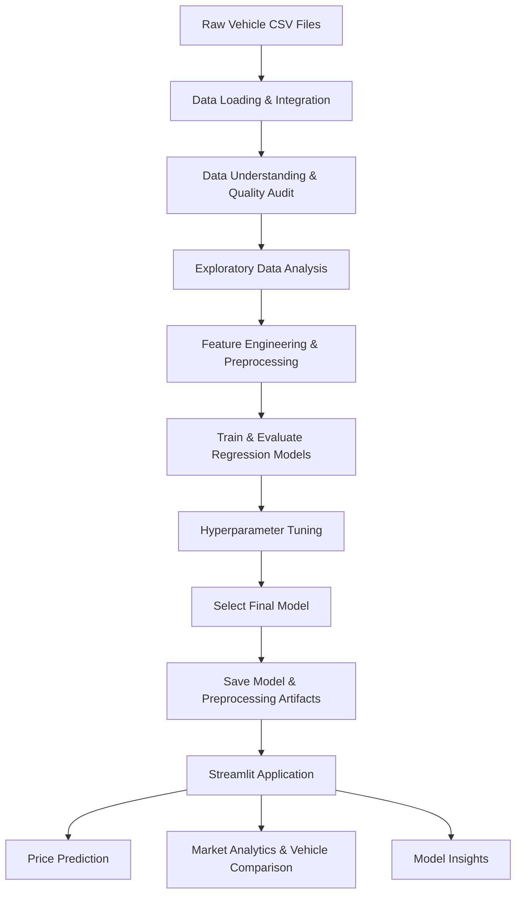

 <div align="center">

# 🚘 CarWise

### Intelligent Used-Car Valuation & Market Analytics

**Drive smarter. Understand the market.**

An end-to-end Machine Learning project that estimates used-car prices
and turns vehicle listings into interactive market insights.

[](https://carwise.streamlit.app/)
[](https://github.com/Khaledelsafy123/CarWise)
[](https://www.kaggle.com/datasets/adityadesai13/used-car-dataset-ford-and-mercedes)
[](https://www.python.org/)
[](https://streamlit.io/)
[](https://scikit-learn.org/)
[](https://lightgbm.readthedocs.io/)

</div>

------------------------------------------------------------------------

## 📌 Project Overview

**CarWise** is an end-to-end Machine Learning application for estimating
the market value of used cars in the UK.

The project combines a trained regression pipeline with an interactive
Streamlit application. Users can enter a vehicle’s specifications to
receive an estimated price, compare that estimate with real listings in
the dataset, analyze an asking price, explore market trends, and compare
multiple vehicles.

The application uses the saved model and preprocessing pipeline. It does
**not** retrain the model when the app starts.

> **Project scope:** Machine Learning regression, model evaluation,
> exploratory data analysis, and interactive data applications.

## 🎯 Project Objectives

- Build a reliable regression workflow for used-car price estimation.
- Explore and understand vehicle listings through EDA.
- Compare multiple regression algorithms using consistent evaluation
  metrics.
- Tune promising models and select a final estimator.
- Package preprocessing and the trained estimator for consistent
  inference.
- Build an interactive application for valuation and automotive market
  analysis.

## 🗂️ Dataset Description

CarWise uses UK used-car listing data covering the following
manufacturers:

- Audi
- BMW
- Ford
- Hyundai
- Mercedes-Benz
- Škoda
- Toyota
- Vauxhall
- Volkswagen

The project keeps the source CSV files under `data/raw/` and the cleaned
dataset used by the application under `data/processed/`.

### Target Variable

| Variable | Description |
|----------|---------------------------------|
| `price`  | Estimated vehicle price in GBP (£) |

### Main Features

| Feature        | Description                     |
|----------------|---------------------------------|
| `manufacturer` | Vehicle manufacturer            |
| `model`        | Vehicle model                   |
| `year`         | Registration year               |
| `mileage`      | Mileage in miles                |
| `fuelType`     | Fuel type                       |
| `transmission` | Transmission type               |
| `engineSize`   | Engine size in litres           |
| `tax`          | Road tax (£)                    |
| `mpg`          | Fuel economy (miles per gallon) |

The saved model pipeline defines the exact input schema used at
prediction time. The application reads that schema from the loaded
artifact rather than creating a separate feature order.

## 🔄 Project Workflow



## 🤖 Model Development

The modeling workflow compares several regression algorithms, including:

- Linear Regression
- Ridge Regression
- Lasso Regression
- Decision Tree
- Random Forest
- Extra Trees
- Gradient Boosting
- Histogram-based Gradient Boosting
- XGBoost
- LightGBM
- CatBoost

Preprocessing utilities are implemented using Scikit-learn pipelines:

- Numerical features: median imputation and standard scaling.
- Categorical features: most-frequent imputation and one-hot encoding.
- `ColumnTransformer` combines the numerical and categorical
  transformations.

The final trained estimator is saved as `artifacts/final_model.joblib`.
Its associated preprocessing is packaged with the model pipeline so
inference uses the same transformations as training.

## 📊 Model Evaluation

Models are compared using:

- **MAE** — Mean Absolute Error
- **RMSE** — Root Mean Squared Error
- **R²** — Coefficient of Determination
- **Median AE** — Median Absolute Error
- **MAPE** — Mean Absolute Percentage Error
- **Explained Variance**

### Final Model — LightGBM (Tuned)

The following values are taken directly from the committed
`artifacts/model_comparison.csv` file.

| Metric                |    Result |
|-----------------------|----------:|
| MAE                   | £1,176.81 |
| RMSE                  | £1,938.82 |
| R²                    |    0.9629 |
| Median Absolute Error |   £786.36 |
| MAPE                  |     7.42% |
| Explained Variance    |    0.9629 |

### Model Comparison

Selected results from the model comparison artifact:

| Model                   |  MAE (£) | RMSE (£) |     R² |
|-------------------------|---------:|---------:|-------:|
| LightGBM (Tuned)        | 1,176.81 | 1,938.82 | 0.9629 |
| Random Forest (Default) | 1,162.00 | 1,975.61 | 0.9615 |
| Extra Trees (Default)   | 1,191.17 | 1,990.25 | 0.9609 |
| CatBoost (Default)      | 1,257.93 | 2,008.02 | 0.9602 |
| CatBoost (Tuned)        | 1,258.66 | 2,010.73 | 0.9601 |

**Selection note:** LightGBM (Tuned) has the highest R² in the saved
comparison results. Random Forest (Default) has a slightly lower MAE and
RMSE, so the preferred model depends on the evaluation metric. CarWise
uses the saved LightGBM pipeline for its predictions.

## 🖥️ Streamlit Application

The application is organized into five sections.

**🌐 Live Demo:** [https://carwise.streamlit.app/](https://carwise.streamlit.app/)

### 1. Dashboard

- Overall dataset statistics.
- Average, median, minimum, and maximum vehicle prices.
- Vehicle price distribution.
- Manufacturer listing counts.
- Price breakdown by fuel type.
- Median price trends by registration year.

### 2. Price Prediction

- Select a manufacturer and vehicle model.
- Enter the vehicle specifications required by the saved model.
- Generate an estimated market value in GBP.
- Compare the estimate with similar listings from the dataset.
- View the median listing price and typical price range for comparable
  vehicles.

#### Asking Price Analysis

After generating a valuation, enter the asking price to compare it with
the CarWise estimate.

The assessment classifies the asking price as:

- Great Deal
- Good Deal
- Fair Price
- Slightly Expensive
- Overpriced
- Too Expensive

The assessment is a simple comparison against the model estimate, not a
guarantee that a vehicle is fairly priced or mechanically sound.

### 3. Market Analysis

- Filter listings by manufacturer, registration year, price range, and
  fuel type.
- Explore price distributions and average prices by manufacturer.
- Analyze price against mileage and registration year.
- Explore transmission and fuel-type distributions.
- Inspect and download filtered records as CSV.

### 4. Car Comparison

- Compare two vehicles, with optional third and fourth vehicles.
- Select actual listings from the dataset.
- Compare price, mileage, registration year, transmission, fuel type,
  engine size, tax, and MPG where available.
- Highlight the lowest price, lowest mileage, and newest registration.
- View side-by-side price and mileage charts.

### 5. Model Insights

- Review the saved model evaluation results.
- Compare models using R², MAE, RMSE, Median AE, MAPE, and Explained
  Variance.
- View the best R² model.
- Explore feature importance when the loaded estimator exposes fitted
  feature importances.

## 🧰 Technologies Used

| Category          | Tools                         |
|-------------------|-------------------------------|
| Language          | Python                        |
| App Framework     | Streamlit                     |
| Data Manipulation | Pandas, NumPy                 |
| Visualization     | Plotly                        |
| Machine Learning  | Scikit-learn                  |
| Gradient Boosting | LightGBM, XGBoost, CatBoost   |
| Model Persistence | Joblib                        |
| Development       | Jupyter Notebook, Git, GitHub |

## 📁 Project Structure

```text
Car_Wise/
│
├── app/
│   └── main.py
│
├── artifacts/
│   ├── final_model.joblib
│   ├── model_comparison.csv
│   ├── preprocessor.joblib
│   └── train_test_split.joblib
│
├── data/
│   ├── raw/
│   │   ├── audi.csv
│   │   ├── bmw.csv
│   │   ├── ford.csv
│   │   ├── hyundi.csv
│   │   ├── merc.csv
│   │   ├── skoda.csv
│   │   ├── toyota.csv
│   │   ├── vauxhall.csv
│   │   ├── vw.csv
│   │   └── vehicles.csv
│   │
│   └── processed/
│       ├── preprocessing_artifacts.joblib
│       └── vehicles_cleaned.csv
│
├── notebooks/
│   ├── 01_Data_Loading_and_Integration.ipynb
│   ├── 02_Data_Understanding_and_Quality_Audit.ipynb
│   ├── 03_Exploratory_Data_Analysis.ipynb
│   ├── 04_Feature_Engineering_and_Preprocessing.ipynb
│   └── 05_Model_Training_and_Evaluation.ipynb
│
├── src/
│   ├── __init__.py
│   ├── models.py
│   └── preprocessing.py
│
├── logo.jfif
├── .gitignore
└── requirements.txt
```

## ⚙️ Installation & Setup

### 1. Clone the Repository

```bash
git clone https://github.com/Khaledelsafy123/Car_Wise.git
cd Car_Wise
```

### 2. Create a Virtual Environment

```bash
python -m venv .venv
```

Activate it:

**Windows PowerShell**

```powershell
.venv\Scripts\Activate.ps1
```

**macOS / Linux**

```bash
source .venv/bin/activate
```

### 3. Install Dependencies

```bash
pip install --upgrade pip
pip install -r requirements.txt
```

## ▶️ Run the Application

From the project root, run:

```bash
streamlit run app/main.py
```

Streamlit will start the application and provide a local URL in the
terminal.

## 🚀 Deployment

CarWise is successfully deployed on **Streamlit Community Cloud**.

- **Live Application:** [https://carwise.streamlit.app/](https://carwise.streamlit.app/)
- **Platform:** [Streamlit Community Cloud](https://share.streamlit.io/)
- **Source Code:** [GitHub Repository](https://github.com/Khaledelsafy123/Car_Wise)
- **Branch:** `main`
- **Main File:** `app/main.py`

## 🔮 Future Improvements

- Add automated tests for prediction and data-loading workflows.
- Add model monitoring and periodic evaluation on newer listings.
- Expand the dataset with additional manufacturers and vehicle listings.
- Improve the valuation context with more detailed comparable-vehicle
  analysis.

## ⚠️ Disclaimer

CarWise provides estimates based on historical vehicle listings and a
trained Machine Learning model. Predictions are informational and should
not be treated as guaranteed selling prices, dealer offers, or
professional vehicle assessments. Actual market value can vary with
vehicle condition, service history, location, and market changes.

---

## 👨‍💻 Author

<div align="center">

### Khaled Elsafy

**Computer Science Student**

<br>

<a href="https://github.com/Khaledelsafy123">
  
</a>
<a href="https://github.com/Khaledelsafy123/CarWise">
  
</a>

<br><br>

**CarWise**
<br>
*Drive smarter. Understand the market.*

</div>
